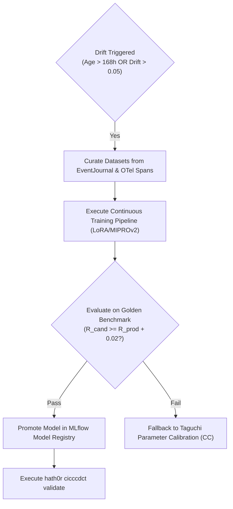

# Playbook: Continuous Training Trigger Conditions & Drift Remediation (CIC³DCT / CIC{qubed}DCT)

> **Document Type:** Playbook  
> **Status:** Ratified  
> **Governing Standards:** `CR-CICCCDCT-001`  
> **Tracking Issues:** Bayly-AI/HATH0R-Agentic-Framework#255, #258

---

## 1. Trigger Conditions

Continuous Training is triggered automatically or by operator intervention under any of the following conditions:

1. **Model Freshness Exceeded:** $\Delta t_{\text{model}} > 168.0\text{ hours}$ (7 days since last verified model training run).
2. **Accuracy Drift:** Accuracy on live agent validation checks drops by $\Delta_{\text{acc}} > 0.05$.
3. **Tokenizer FinOps Tax Spike:** Token consumption exceeds baseline budget by $\Delta_{\text{tok}} > 0.15$.
4. **New Tool or Schema Release:** Major or minor version bump in contracts (`contracts/schemas/`).

---

## 2. Remediation Protocol



### Action Steps:
1. Inspect current status:
   ```bash
   hath0r cicccdct status
   ```
2. If drift is within hyperparameter tolerance ($\Delta_{\text{acc}} \le 0.05$), run calibration first:
   ```bash
   hath0r cicccdct calibrate
   ```
3. If drift exceeds parameter threshold or training SLA expired:
   ```bash
   hath0r cicccdct train run --target reasoning_slm --epochs 3
   ```
4. Verify promotion and gate status:
   ```bash
   hath0r cicccdct validate
   ```
