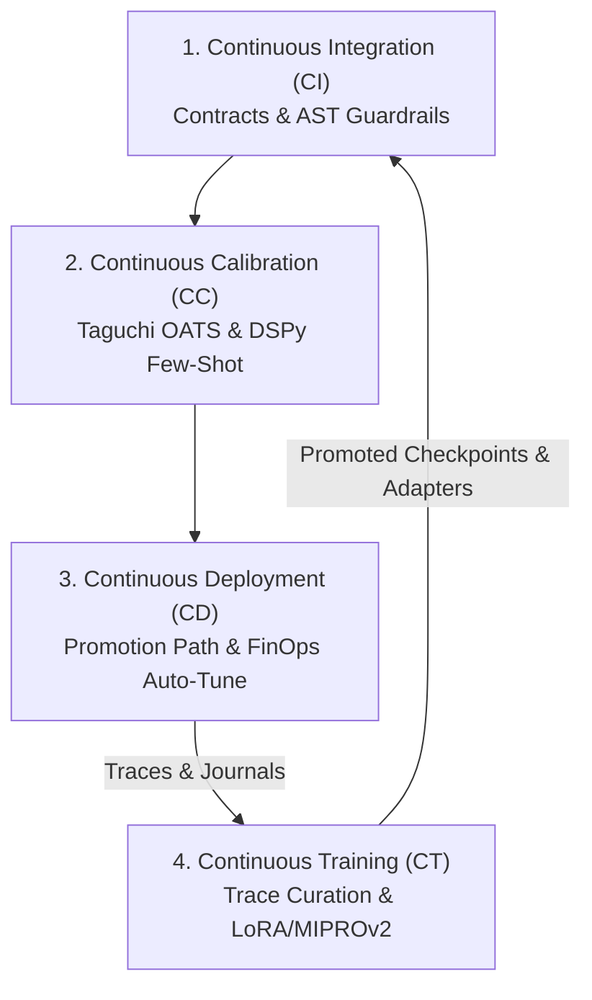

# Strategy: Continuous Integration, Calibration, Deployment & Continuous Training (CICCCDCT)

> **Document Type:** Strategy  
> **Status:** Ratified Canonical Specification  
> **Governing Rules:** `CR-CICCCDCT-001`, `CR-CLI-ENTRY-001`, `CR-AGENTGRAPH-001`, `CR-BAI-001`  
> **Tracking Issues:** Bayly-AI/HATH0R-Agentic-Framework#255, #256

---

## 1. Executive Summary & Paradigm Shift

In generative agent ecosystems, traditional deterministic CI/CD and runtime calibration (CC) address software reliability and hyperparameter stability, but cannot remediate structural cognitive drift when foundational reasoning capabilities degrade or new tools and schemas emerge.

**CICCCDCT** establishes a closed-loop 4-pillar methodology:
1. **Continuous Integration (CI):** Validates deterministic contracts, JSON schemas, AST syntax guardrails, and AgentGraph policy DAGs.
2. **Continuous Calibration (CC):** Samples span telemetry via `CICCCDCTTelemetryHook` and optimizes hyperparameters (temperature, token budgets, guardrails) using Taguchi Orthogonal Arrays and DSPy few-shot compilation within a 24.0h freshness SLA.
3. **Continuous Deployment (CD):** Manages strict environment promotions (`dev` -> `test` -> `staging` -> `master`), FinOps auto-tuning, and living documentation hexad synchronization.
4. **Continuous Training (CT):** Synthesizes curated training datasets from production traces and `EventJournal` executions, conducts fine-tuning (LoRA/QLoRA on SLMs, DSPy MIPROv2 teleprompter compilation), evaluates candidate models against golden benchmarks using multi-objective RL reward functions, and logs models into the MLflow Model Registry.

---

## 2. Multi-Objective Evaluation & Promotion Invariant

Candidate models or compiled prompt adapters generated during Continuous Training are evaluated against production baselines using the multi-objective reward formulation:

$$R_{\text{total}} = w_1 R_{\text{acc}} + w_2 R_{\text{finops}} - w_3 R_{\text{lat}} - w_4 R_{\text{constraint}}$$

Where:
- $w_1 = 0.50$ (Task accuracy and assertion satisfaction)
- $w_2 = 0.25$ (Tokenizer tax and budget efficiency)
- $w_3 = 0.15$ (Latency penalty relative to target SLA)
- $w_4 = 0.10$ (Deterministic constraint violations)

**Promotion Invariant:**
A candidate model version is eligible for promotion to `Staging` and `Production` if and only if:
$$R_{\text{candidate}} \ge R_{\text{production}} + 0.02$$
with zero regression on schema contracts and AST syntax guardrails.

---

## 3. SLA Matrix & Drift Thresholds

| Pillar | Metric / Condition | Threshold | Enforcement Tool |
| :--- | :--- | :--- | :--- |
| **CI** | Schema Contract Parity | 100% In-Sync | `hath0r contracts validate` |
| **CI** | SAST Vulnerability Gate | 0 High / Critical | `hath0r cicccdct validate` |
| **CC** | Calibration Freshness | $\le 24.0\text{ hours}$ | `hath0r cicccdct status` |
| **CC** | Accuracy Drift ($\Delta_{\text{acc}}$) | $< 0.05$ | `TaguchiLossOptimizer` |
| **CD** | Artifact Hexad Parity | 100% Complete | `hath0r docs share` |
| **CT** | Model Training Freshness | $\le 168.0\text{ hours}$ (7 days) | `CICCCDCTTelemetryHook` |
| **CT** | Retraining Trigger Drift | $\Delta_{\text{acc}} > 0.05 \lor \Delta_{\text{tok}} > 0.15$ | Automated Alert / Bot Trigger |

---

## 4. Operational CLI & MCP Interfaces

- **CLI Operator:** `hath0r cicccdct [status|validate|calibrate|train|dataset|model|auto-tune]`
- **MCP Server Tools:** `hath0r_cicccdct_status`, `hath0r_cicccdct_train`, `hath0r_cicccdct_validate`, `hath0r_model_registry_promote`
