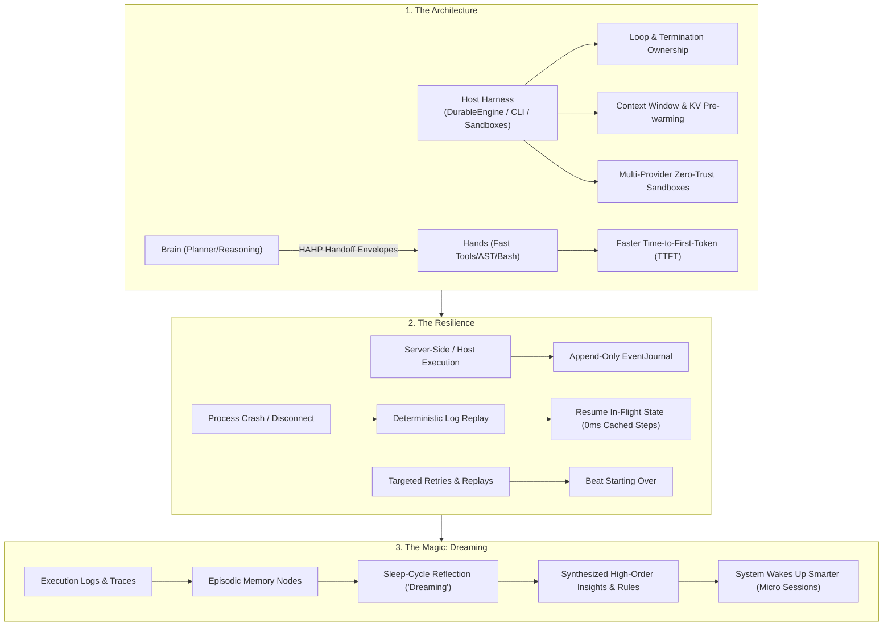

# Canonical Agentic Architecture: Harness, Resilience, and Dreaming Strategy

> **Status:** Ratified Architectural Specification  
> **Classification:** Canonical Suite Standard  
> **Role:** Unified Architecture Blueprint for HATH0R Cognitive Substrate & CLI  
> **Governing Rules:** `CR-SUBSTRATE-001`, `CR-CLI-ENTRY-001`, `CR-AGENTGRAPH-001`, `CR-MEMORY-COMPOUND-001`

---

## 1. Executive Summary

Autonomous agentic systems cannot rely on naive, client-side, in-memory execution loops. Ephemeral loops crash on timeouts, waste massive token budgets by restarting from scratch, and forget operational learnings as soon as the session process terminates.

This strategy ratifies the canonical three-pillar architecture governing HATH0R CLI and the framework substrate:

---

## 2. Pillar 1: The Architecture

### 2.1 Harness Owns Loops, Context, and Sandboxing

In HATH0R, the LLM is treated as a guest reasoning engine; it **does not manage its own execution loop or environment**. The host **Harness** (`DurableWorkflowEngine`, `step_runner`, `agent_dag_runner`) strictly owns:

1. **Loop & Termination Governance**:
   - The harness maintains the iteration loop, monitors step exit codes, enforces maximum step ceilings, evaluates deterministic completion criteria, and manages human suspension gates (`HumanHibernationGate`).
2. **Context Assembly & Token Governance**:
   - Zero-prompt-tax doctrine (`CR-AGENTGRAPH-001` / `CR-RAG-RETRIEVAL-001`): The harness never stuffs unbounded file trees into prompts.
   - Bounded retrieval is assembled via `AgentGraph` queries and semantic cache lookups (`SemanticCache`).
   - Shared system contexts are pre-warmed via PagedAttention KV pre-warmer (`kv_prewarmer` / `hath0r agent prewarm`), slashing prefill latency.
3. **Zero-Trust Sandboxing**:
   - Untrusted commands, code transformations, and dynamic tools run within isolated sandboxes (`hath0r_engine.sandbox`):
     - **E2B MicroVMs** (`E2BSandboxProvider`)
     - **Daytona Environments** (`DaytonaSandboxProvider`)
     - **Local Containers / Runners** (`LocalSandboxProvider`)
     - **WebAssembly Sandboxes** (`WasmSandbox`)
   - The harness enforces strict read-only/isolated boundaries, preventing rogue host modification.

### 2.2 Brain and Hands Split → Faster to First Token

Monolithic agents that execute reasoning, syntax analysis, and tool dispatch in a single sequential token generation suffer from severe latency bottlenecks (high Time-to-First-Token and delayed Time-to-Action).

HATH0R enforces a structural split between **Brain** and **Hands**:

| Component | Responsibility | Technology & Model Tier |
|---|---|---|
| **Brain** (Planner / Architect) | Deep strategic reasoning, DAG decomposition, DSPy pipeline synthesis, multi-step dependency planning | `ComplexityTier.REASONING` / `STANDARD` (Claude 3.5 Sonnet, o3-mini, DeepSeek-R1) |
| **Hands** (Tool Executor / Worker) | Fast tool execution, file edits, AST transforms, regex searches, bash execution, syntax verification | `ComplexityTier.LIGHT` (Claude 3.5 Haiku, Qwen 2.5 Coder, GPT-4o-mini) + Deterministic AST bots |

- **Communication Protocol**: Brain and hands communicate via structured **HAHP (Hath0r Agent Handoff Protocol)** envelopes (`hath0r agent hahp`).
- **TTFT Optimization**: Fast streaming workers emit immediate user-facing tokens and start preliminary tool execution while background reasoning plans synchronize, achieving sub-second first-token latencies.

---

## 3. Pillar 2: The Resilience

### 3.1 Server-Side Execution with Log-Based Resume After Crashes

Agent workflows do not run ephemeral in client memory. All long-running operations are mediated through host-side durable state machines:

1. **Append-Only Event Journal (`hath0r_engine.orchestration.EventJournal`)**:
   - Backed by an immutable SQLite store or write-ahead log.
   - Records monotonic event records: `WORKFLOW_STARTED`, `STEP_STARTED`, `STEP_COMPLETED`, `STEP_FAILED`, `STATE_MUTATED`, `HUMAN_PAUSED`.
2. **Crash Recovery via Replay (`engine.replay()`)**:
   - If an agent runner process crashes, worker node restarts, or network disconnects:
   - On boot, the engine reads the journal history for the `workflow_id`.
   - The exact state machine is reconstructed by replaying logged events.
   - In-flight execution resumes exactly where it was interrupted with zero data loss.

### 3.2 Retries and Replays Beat Starting Over

Restarting a 15-step agent workflow from step 1 when step 12 fails is intolerable in production.

1. **Step Memoization**:
   - Every deterministic step specifies an `idempotency_key`.
   - `DurableWorkflowEngine.run_step()` checks `journal.find_step_result(workflow_id, key)`.
   - Previously completed steps are replayed instantly from the journal in 0ms with zero token expenditure and zero duplicate side-effects.
2. **Targeted Retries & In-Flight Repair**:
   - Only the failed step is subjected to retry policies (with exponential backoff) or schema repair (`SchemaRepairEngine`).
   - Workflows can suspend into `HUMAN_PAUSED` hibernation without consuming compute, awaiting explicit approval before resuming.

---

## 4. Pillar 3: The Magic (Logs Become Memory / "Dreaming")

### 4.1 Logs Become Memory

Raw execution traces, step outputs, tool failure logs, and telemetry events (`.hath0r/spool/telemetry-*.jsonl`) are systematically harvested:
- Transformed into episodic memory nodes (`type: "episode"`, `"decision"`, `"fact"`) within `.hath0r/memory/graph.json`.
- Enriched with execution metadata, tags, performance metrics, and causal lineage edges (`RELATES_TO`, `RESOLVES`).

### 4.2 Autonomous Sleep-Cycle Reflection ("Dreaming")

Anthropic terms this offline memory consolidation process **"Dreaming"**:
- When tasks conclude, during idle periods, or upon triggering `hath0r memory dream` / `hath0r memory reflect`:
- The **Reflection Engine** (`ReflectionEngine` / `MemoryManagerBot.reflect_memory()`):
  1. Clusters episodic memories and execution logs by semantic tags and error themes.
  2. Extracts high-frequency patterns, error signatures, and operational best practices.
  3. Synthesizes high-order `insight` and `rule` nodes with aggregated importance scores.
  4. Automatically links insights back to source episodes via `DERIVES_FROM` and `ENFORCES` graph edges.
  5. Prunes decayed, low-importance ephemeral nodes.
  6. Promotes recurring high-confidence insights into canonical KnowledgeGraph policy specifications (`promote_to_knowledge`).

### 4.3 The System Wakes Up Smarter

When an operator or agent starts a new session (`hath0r memory session start`):
1. The micro memory session reads the prior session's state (`latest.json`).
2. The engine executes compact associative recall (`_recall_top_nodes_compact()`), injecting top distilled insights into active working memory (`current.json`).
3. The agent enters the new task already knowing:
   - What failed previously in this codebase
   - Which tools and flags succeeded
   - Specific architectural constraints discovered in previous runs
4. **Result:** Zero prompt tax, zero repetition of past failures. The system wakes up smarter.

---

## 5. CLI Operator Interface

The HATH0R CLI directly exposes and operationalizes these canonical pillars:

| Command | Pillar | Purpose |
|---|---|---|
| `hath0r agent architecture` | All | Inspect full status of Harness, Brain-Hands split, Resilience, and Dreaming. |
| `hath0r agent prewarm` | Architecture | Pre-warm PagedAttention KV cache on shared prompt context to slash TTFT. |
| `hath0r agent hahp` | Architecture | Issue and inspect Brain-to-Hands state handoff envelopes. |
| `hath0r agent dag` | Architecture | Execute multi-agent DAG workflows with parallel fan-out and barriers. |
| `hath0r memory session start` | Magic | Start micro session and wake up smarter by recalling top distilled insights. |
| `hath0r memory dream` | Magic | Trigger Anthropic-style sleep-cycle reflection and log-to-memory consolidation. |
| `hath0r memory verify` | Governance | Verify CR-MEMORY-COMPOUND-001 pre-announcement memory gate. |
