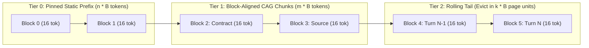

# PagedAttention Chunk-Boundary KV-Cache Alignment & Eviction Strategy

> **Status:** Ratified Architectural Specification  
> **Parent Issues:** Bayly-AI/HATH0R-Agentic-Framework#297, Bayly-AI/HATH0R-CLI#482  
> **Governing Standards:** `CR-CLI-ENTRY-001`, `CR-SUBSTRATE-001`, `CR-AGENTGRAPH-001`  
> **Updated:** 2026-10-17  

---

## 1. Executive Summary & Problem Statement

> *"PagedAttention eliminates jitter only when the KV‑cache eviction policy respects chunk boundaries; mismatched eviction forces page reloads and erodes the latency benefit."*

In vLLM's **PagedAttention** with Automatic Prefix Caching (APC), GPU KV-cache memory is partitioned into fixed-size physical token blocks of size $B \in \{16, 32\}$ tokens (`--block-size`). Each logical block $i$ is indexed by a rolling cryptographic hash over its token slice and all preceding blocks:

$$\text{BlockHash}_i = H\left(\text{BlockHash}_{i-1}, \; \text{Tokens}_{[i \cdot B \, : \, (i+1) \cdot B]}\right)$$

When an agentic framework mutates or evicts $k$ tokens from an upstream prompt section or rolling context window where $k \not\equiv 0 \pmod B$, every downstream token shifts by $k \bmod B$ positions. This shift alters the token composition of **every subsequent block**, invalidating $100\%$ of downstream $\text{BlockHash}_i$ pointers and forcing full GPU KV-page reloads and prefill stalls (TTFT jitter).

---

## 2. Architectural Invariants

To guarantee zero-jitter KV-cache reuse across multi-turn agent loops, CAG context packing, and working memory paging, Hath0r enforces three deterministic invariants:

1. **Strict Prefix Stability Tiering (`STATIC` $\to$ `SEMI_STATIC` $\to$ `DYNAMIC_TAIL`):**
   - **Tier 0 (Pinned Static Prefix):** System instructions, `RulesGraph` invariants, and canonical tool schemas. Never evicted; padded to exact multiples of $B$ tokens.
   - **Tier 1 (Semi-Static CAG / Knowledge Blocks):** Workspace files and `KnowledgeGraph` subgraphs sorted deterministically by stability (immutable contracts/schemas first, frequently edited source files last), with each chunk padded to a multiple of $B$ tokens.
   - **Tier 2 (Dynamic Rolling Tail):** Ephemeral turn history, scratchpad state, and `MemorySession` micro-entries. Eviction occurs exclusively in quantized multiples of $B$ tokens from unpinned blocks without shifting Tier 0 or Tier 1 block boundaries.

2. **Chunk-Boundary Token Alignment ($L \equiv 0 \pmod B$):**
   Every discrete prompt segment packed by `ChunkAlignedKVEvictionPolicy`, `KVCachePrewarmer`, or `CAGEngine` is quantized and padded to an exact multiple of `kv_block_size` ($B = 16$ tokens by default) using deterministic whitespace/comment delimiters so that segment boundaries coincide with physical vLLM KV page boundaries.

3. **Block-Quantized Eviction (`ChunkAlignedKVEvictionPolicy`):**
   When working memory or prompt context exceeds the token budget, eviction removes whole $B$-token pages (`evicted_tokens % B == 0`) starting from the lowest-priority unpinned tail blocks, preserving contiguous prefix page hashes and preventing page reload cascades.

---

## 3. Target Subsystems

- **Framework Gateway (`src/hath0r_engine/gateway/`):**
  - `ChunkAlignedKVEvictionPolicy` & `KVBlockChunk` in `src/hath0r_engine/gateway/cache.py`
  - `GatewayConfig` fields `kv_block_size: int = 16`, `enable_chunked_prefill: bool = True`, and `chunk_aligned_eviction: bool = True` in `src/hath0r_engine/gateway/base.py`
- **Framework Memory Paging (`src/hath0r_engine/memory/`):**
  - `MemoryPagingManager.pack_block_aligned_context()` and chunk-boundary eviction in `src/hath0r_engine/memory/memory_tools.py`
- **Operator CLI (`HATH0R-CLI`):**
  - `KVCachePrewarmer` rolling block-hash computation and chunk-boundary eviction in `src/hath0r_cli/bots/kv_prewarmer.py`
  - `CAGEngine` stability-sorted, block-aligned context packing in `src/hath0r_cli/bots/cag_engine.py`
  - `hath0r agent prewarm --block-size 16` CLI flags in `src/hath0r_cli/commands/agent.py`
