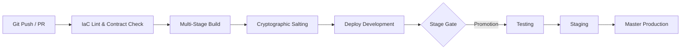

# Workflow: Continuous Delivery of Infrastructure as Code & Salted Containers

> **Document Type:** Workflow  
> **Status:** Ratified  
> **Governing Standards:** `CR-IAC-001`, `CR-CICCCDCT-001`, `CR-BAI-001`  
> **Target Subsystems:** GitHub Actions, AWS EKS Deployment Pipelines  
> **Tracking Issues:** Bayly-AI/HATH0R-Agentic-Framework#260, Bayly-AI/HATH0R-CLI#441

---

## 1. Lifecycle Overview

This workflow automates the validation, container build, cryptographic salting, and staged continuous delivery of workloads across environments:

---

## 2. Pipeline Stages

### Stage 1: Continuous Integration & IaC Validation
- Trigger: Pull requests targeting `development`.
- Actions:
  - Run `hath0r contracts validate`
  - Run `hath0r iac validate .`
  - Run Dockerfile SAST scan (`hadolint` / `trivy`)

### Stage 2: Container Build & Salting
- Trigger: Merge into `development`.
- Actions:
  - Execute multi-stage BuildKit compilation.
  - Push image layers to Amazon ECR.
  - Pin immutable image SHA-256 digest.
  - Sign image digest with Cosign using GitHub OIDC token.
  - Record attestation receipt in workflow metadata.

### Stage 3: Progressive Environment Promotion
- Follows canonical promotion sequence: `development` -> `testing` -> `staging` -> `master`.
- In each environment:
  - Synchronize EKS Fargate Profile.
  - Render environment manifests via `hath0r iac render --env <target>`.
  - Apply Kubernetes resources to target namespace.
  - Run Playwright E2E and healthcheck probes.
